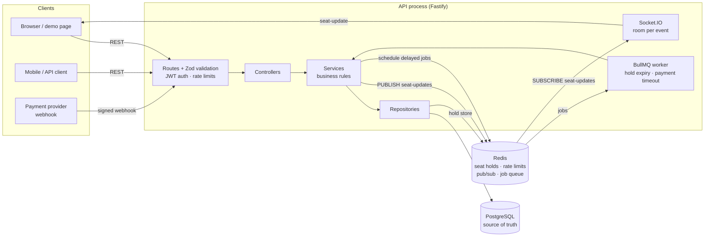

# Event Ticket Booking System (Backend)

A backend for booking seats at events such as college fests, hackathons and shows. Organisers create events and seat layouts. Attendees hold seats for a few minutes, book them, pay (mocked) and get QR tickets that are scanned at the gate.

**The core guarantee: two people can never book the same seat, even if they click at the same millisecond.** A test proves it by firing 20 simultaneous requests at one seat. See [How double booking is prevented](#how-double-booking-is-prevented).

**Stack:** Node.js + TypeScript · Fastify · PostgreSQL + Prisma · Redis · BullMQ · Socket.IO · Zod · JWT + bcrypt · Jest + Supertest · Docker Compose · Swagger · Pino

---

## Quick start

```bash
docker compose up --build
```

| What | Where |
| --- | --- |
| Live seat-map demo | http://localhost:3000/demo |
| Swagger / OpenAPI docs | http://localhost:3000/docs |
| Health check | http://localhost:3000/health |

The stack seeds demo data on first start: 1 organiser, 3 attendees and 2 events with 50 seats each. Every account's password is `password123`.

| Email | Role |
| --- | --- |
| `organiser@demo.dev` | ORGANISER |
| `alice@demo.dev`, `bob@demo.dev`, `carol@demo.dev` | ATTENDEE |

### Running the demo

1. Open `http://localhost:3000/demo?user=alice@demo.dev` in one window and `http://localhost:3000/demo?user=bob@demo.dev` in another, side by side.
2. Both of you select the same seat and press **Hold seats**.
3. One window gets the seat, which turns blue. The other gets a "Too slow!" message, and the seat turns grey in front of them. No refresh is needed; the update arrives over WebSockets.
4. The winner presses **Confirm booking**, then **Pay (mock)**, to get a QR ticket.
5. Press **Scan at gate** twice: the first scan admits the ticket and the second is rejected.

### Running tests

Tests need Postgres and Redis. Compose provides both, plus a separate `ticketing_test` database so tests never touch demo data.

```bash
npm install
npm run test:deps   # docker compose up -d postgres redis
npm test
```

### Local development without Docker for the app

```bash
cp .env.example .env
npm run test:deps        # just postgres + redis
npx prisma migrate deploy
npm run seed
npm run dev              # tsx watch, pretty logs
```

---

## Architecture



- **Layering:** `routes → controllers → services → repositories`. Routes declare the URL, auth and OpenAPI docs. Controllers parse input with Zod and shape the response. Services hold the business rules. Repositories are the only code that talks to Postgres or Redis.
- **Postgres is the source of truth** for bookings. **Redis is the fast layer** for short-lived holds, rate-limit counters, pub/sub and the job queue. If Redis lost all its data, no booking would be lost or duplicated.
- **Why go through Redis pub/sub for WebSockets?** Seat changes can come from any API instance or from the background worker. Each instance subscribes to one channel and forwards messages to its own connected browsers, so the design scales horizontally without sticky routing for updates.
- The worker runs inside the API process by default (`RUN_WORKER=true`) to keep the demo to one container. It's an independent BullMQ consumer, so it can run as its own service.

### Project layout

```
src/
  app.ts, server.ts         Fastify setup · startup and graceful shutdown
  config.ts                 env vars validated with Zod (fails fast on bad config)
  lib/                      prisma, redis, logger, errors, jwt, validation helpers
  plugins/                  auth hooks, error handler, rate limiter, swagger
  modules/
    auth/ events/ holds/ bookings/ tickets/ payments/
      *.routes.ts → *.controller.ts → *.service.ts → *.repository.ts (+ *.schemas.ts)
  realtime/                 publish seat updates, Socket.IO bridge
  jobs/                     BullMQ queue and worker
  scripts/                  seed, mock-pay
prisma/                     schema + migrations (includes the partial unique index)
public/demo.html            static seat-map demo (no framework)
tests/                      unit/ + integration tests
```

---

## Booking flow

```mermaid
sequenceDiagram
    actor U as Attendee
    participant API
    participant R as Redis
    participant DB as Postgres
    participant Q as BullMQ
    participant P as Payment provider

    U->>API: POST /events/:id/holds {seatIds}
    API->>R: Lua: all seats free? then SET each seat key (EX 300)
    API->>DB: any of these seats already booked?
    API->>Q: delayed job "hold-expiry" (+5 min)
    API-->>U: 201 {holdId, expiresAt, totalAmount}

    U->>API: POST /bookings {holdId} + Idempotency-Key
    API->>R: hold still mine? every seat key still = holdId?
    API->>DB: BEGIN; read prices; INSERT Booking(PENDING) + BookingSeats; COMMIT
    API->>R: release seat keys (DB protects the seats now)
    API->>Q: delayed job "payment-timeout" (+10 min)
    API-->>U: 201 {booking: PENDING, paymentDueBy}

    P->>API: POST /payments/webhook (HMAC signed)
    API->>DB: BEGIN; PENDING→CONFIRMED; INSERT Tickets (signed QR); COMMIT
    U->>API: GET /bookings/:id/tickets → QR codes
```

Seat status as shown to clients:

| Status | Meaning | Stored in |
| --- | --- | --- |
| `AVAILABLE` | free | (absence of the two below) |
| `HELD` | someone is checking out (temporary, expires on its own) | Redis key `seat:{eventId}:{seatId}` |
| `BOOKED` | in a PENDING or CONFIRMED booking | Postgres `BookingSeat` with `active = true` |

---

## How double booking is prevented

There are three layers. Each layer alone would stop most races, and the database layer alone is enough to guarantee correctness.

### 1. Atomic, all-or-nothing hold in Redis

Each seat is a Redis key: `seat:{eventId}:{seatId} = holdId` with a 5-minute TTL. A **Lua script** checks that every requested seat is free and then sets all of them. Redis runs a script to completion before running any other command, so two requests for the same seat can't interleave: one sees the seat free and takes it, and the other sees it taken and gets **409** with the taken seat ids.

```lua
for each seat key: if EXISTS → add to "taken"
if taken is not empty → return taken          -- set nothing
for each seat key: SET key holdId NX EX 300   -- set all
```

The brief suggests "SET NX each seat, and if any fail, release the rest". The Lua version gives the same result without a release step: a failed hold never touches any seat, so there's no window in which other users see half-held seats.

The value is the **holdId** rather than the userId. Booking checks that every seat key still points at *this* hold. Release is a compare-and-delete (also Lua), so an old hold can never delete a newer hold that someone else placed after it expired.

### 2. Hold first, then check the database

After grabbing the Redis keys, the hold service checks Postgres for an active booking of those seats. The order matters: a booking deletes its Redis keys only after its transaction commits. So if we got the key, any earlier booking of that seat is already committed and visible to our check.

### 3. The database has the final say: a partial unique index

```sql
CREATE UNIQUE INDEX "BookingSeat_seatId_active_key" ON "BookingSeat"("seatId") WHERE "active";
```

A seat can belong to at most **one active** (pending or confirmed) booking. Cancelled bookings set `active = false`, which frees the seat without deleting history. The booking is created in a single transaction (read prices → insert `Booking` → insert `BookingSeat` rows). If any seat is already taken, Postgres rejects the insert, the whole transaction rolls back, and the API returns **409 `SEATS_ALREADY_BOOKED`**.

This layer covers everything the other two can't: a hold that expires mid-checkout and gets re-held, clock skew, a Redis failover that loses keys, or a bug in our own code. A test bypasses Redis entirely, fires 20 concurrent inserts for one seat, and asserts exactly one succeeds.

Prisma's schema language can't express partial indexes, so this index is hand-written in the migration SQL (`prisma/migrations/.../migration.sql`).

### Idempotency: a retry or double-click never creates a second booking

`POST /bookings` requires an `Idempotency-Key` header. `Booking` has a unique constraint on `(userId, idempotencyKey)`.

- Same key, same hold: the original booking is returned with header `Idempotent-Replayed: true`.
- Same key, different hold: **422 `IDEMPOTENCY_KEY_REUSED`**, because that's a client bug.
- Two requests with the same key arrive *at the same time*: one wins the insert. The loser fails (either the hold is gone or the unique key is violated), sees the winner's booking under that key, and returns it. A test sends 20 concurrent requests with one key and gets 20 identical responses and one row.

### Other races handled the same way

- **Ticket check-in:** `UPDATE ... WHERE id = ? AND checkedInAt IS NULL`. If two gates scan the same QR at once, exactly one update matches. (Tested with 10 concurrent scans.)
- **Payment vs. payment timeout:** confirm is `UPDATE ... WHERE status = 'PENDING'`, and so is the timeout's cancel. Whichever commits first wins, and the other does nothing.

### What the tests prove (`tests/concurrency.int.test.ts`)

| Scenario | Result |
| --- | --- |
| 20 users hold the same seat simultaneously | exactly 1 × 201, 19 × 409 |
| 20 users hold-then-book the same seat simultaneously | exactly 1 booking row |
| 20 booking requests for one hold, different keys | 1 × 201, 19 × 409 |
| 20 requests with the same Idempotency-Key | 20 × 201, all the same booking id, 1 row |
| 20 direct DB inserts for one seat, Redis bypassed | 1 succeeds, 19 unique violations |

---

## API summary

All routes are under `/api/v1`. Full request and response schemas are at `/docs`. Prices are integers in **paise** (minor units, so money never touches floating point), and the server always computes totals; prices sent by the client are ignored.

| Method | Path | Who | Description |
| --- | --- | --- | --- |
| POST | `/auth/register` | public | Create account (`ATTENDEE` default, or `ORGANISER`) |
| POST | `/auth/login` | public | Returns a JWT |
| GET | `/auth/me` | any user | Current user |
| POST | `/events` | organiser | Create a draft event |
| PATCH | `/events/:id` | owner | Edit an event |
| POST | `/events/:id/publish` | owner | Publish a draft (needs ≥ 1 seat, a future start) |
| GET | `/events` | public | Published events. `page`, `pageSize`, `from`, `to`, `venue`, `search` |
| GET | `/events/:id` | public* | One event (*drafts only visible to their organiser) |
| POST | `/events/:id/seats` | owner | Bulk layout: `{ rows: [{ row: "A", seats: 10, tier: "VIP", price: 150000 }] }` |
| GET | `/events/:id/seats` | public | Every seat with `AVAILABLE` / `HELD` / `BOOKED` |
| POST | `/events/:id/holds` | attendee | `{ seatIds }` → hold for `HOLD_TTL_SECONDS` (default 5 min) |
| DELETE | `/holds/:holdId` | hold owner | Release early |
| POST | `/bookings` | attendee | `{ holdId }` + `Idempotency-Key` → `PENDING` booking |
| GET | `/bookings/me` | attendee | My bookings |
| POST | `/bookings/:id/cancel` | owner | Cancel and free the seats (before the event starts) |
| GET | `/bookings/:id/tickets` | owner | QR tickets (once `CONFIRMED`) |
| POST | `/tickets/verify` | event's organiser | `{ qrToken }` → check in; a second scan returns 409 |
| POST | `/payments/webhook` | payment provider | HMAC-SHA256 of the raw body in `X-Razorpay-Signature` |
| POST | `/payments/mock-checkout` | attendee | **Demo only** (`MOCK_PAYMENTS_ENABLED`): signs a webhook and runs it through the same verification |

**WebSocket (Socket.IO):** emit `join-event` with an event id. You'll receive `seat-update` messages shaped `{ eventId, seats: [{ seatId, status }] }`.

### Errors

Every error has the same shape:

```json
{ "error": { "code": "SEATS_UNAVAILABLE", "message": "Some of these seats were just taken by someone else", "details": { "seatIds": ["…"] } } }
```

Common codes: `VALIDATION_ERROR` (400), `UNAUTHORIZED` (401), `FORBIDDEN` (403), `NOT_FOUND` (404), `SEATS_UNAVAILABLE` / `SEATS_ALREADY_BOOKED` / `HOLD_EXPIRED` / `ALREADY_CHECKED_IN` (409), `IDEMPOTENCY_KEY_REUSED` (422), `RATE_LIMITED` (429).

---

## Other features

- **Payments (mocked, Razorpay-style).** Booking creates a `PENDING` booking that locks the seats in Postgres. A signed `payment.captured` webhook moves it to `CONFIRMED` and issues tickets. `payment.failed`, or the **payment-timeout job** (`PAYMENT_TIMEOUT_SECONDS`, default 10 min), cancels it and frees the seats. Webhooks are verified with a constant-time HMAC comparison over the raw bytes, and replaying the same webhook is a no-op. To pay from the CLI: `npm run pay -- <bookingId> [fail]`.
- **QR tickets.** Each ticket's QR encodes a JWT `{ tid, eid, typ: "ticket" }` signed with `QR_SECRET`, a separate secret from login tokens, so a login token can't be passed off as a ticket. The scanner verifies the signature, checks the organiser owns the event and the booking is still confirmed, then checks the ticket in exactly once.
- **Hold expiry.** Redis TTL frees the seat even if every job fails. The BullMQ **hold-expiry** job exists to *tell* watching browsers (it broadcasts `AVAILABLE` only for seats that weren't booked or re-held in the meantime). Both jobs are idempotent, because BullMQ delivers "at least once".
- **Rate limiting.** A Redis fixed-window counter (`INCR` + `EXPIRE`) that works across instances. It's per IP on login/register and per user on holds and bookings, with `X-RateLimit-*` and `Retry-After` headers.
- **Validation.** Zod validates every input (body, params, query, headers). Fastify's own validator is switched off, and the same Zod schemas generate the OpenAPI docs.
- **Ops.** Validated env config (the process exits on bad config). Structured Pino logs with a request id per request (it honours an incoming `X-Request-Id` and echoes it back). Graceful shutdown on SIGTERM/SIGINT drains HTTP and WebSockets, then closes the worker, queue, DB and Redis. The Docker image runs node as PID 1 so `docker stop` triggers that path.

---

## Design decisions and trade-offs

| Decision | Why | Trade-off |
| --- | --- | --- |
| Redis holds + Postgres constraint | Redis gives fast, auto-expiring holds; Postgres gives a guarantee | Two systems to reason about; Redis is treated as an optimisation, never the guarantee |
| Partial unique index instead of deleting rows on cancel | Keeps booking history while freeing the seat | Raw SQL in the migration (Prisma can't model it); `prisma migrate dev` may try to drop it, so new migrations should be generated with `migrate diff` and reviewed |
| Seat key value is the holdId, not the userId | Lets booking/release prove ownership of *this* hold | Slight deviation from the brief's `SET seat:… {userId}` |
| Tickets issued on payment, not at booking | Gives `PENDING` a real meaning; no tickets for unpaid seats | One extra step (webhook) before tickets exist |
| Idempotent replay returns the *current* booking | Simple, and the guarantee that matters (no second booking) holds | If the booking was paid in between, the replay shows `CONFIRMED` rather than the byte-identical original response |
| Fixed-window rate limiting | One `INCR` per request, easy to explain | Allows a burst of up to 2× at window edges |
| Worker runs in the API process by default | One container for the demo | In production, run it as its own deployment |
| Prices in integer paise | No floating-point money bugs | Clients must format for display |

**Not built (deliberately out of scope):** refresh tokens, a real payment gateway and refunds, event cancellation cascading to bookings, Redis Cluster key hash-tags, and multi-instance load testing.
