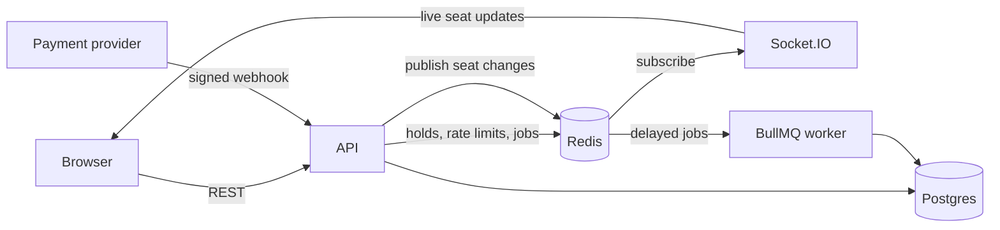

# Ticket Queue System

Backend for booking seats at college events: fests, hackathons, shows. The demo is themed for Odyssey, a college fest, where a popular event opens for booking and everyone hits "book" at the same time.

The main thing I wanted to get right: **two people should never end up with the same seat**, no matter how close together they click. There's a test that fires 20 requests at one seat at once, and exactly one of them wins.

Built with Node + TypeScript (Fastify), Postgres (Prisma), Redis, BullMQ, Socket.IO, Zod, and Jest. It all runs in Docker.

## Running it

```bash
docker compose up --build
```

Then open:

- http://localhost:3000/demo for the seat map
- http://localhost:3000/docs for the Swagger docs

On first start it seeds an organiser, three attendees and two events with 50 seats each. Every account's password is `password123`:

- `organiser@demo.dev` (organiser)
- `alice@demo.dev`, `bob@demo.dev`, `carol@demo.dev` (attendees)

### Trying the race yourself

Open these two side by side:

- http://localhost:3000/demo?user=alice@demo.dev
- http://localhost:3000/demo?user=bob@demo.dev

Pick the same seat in both and hit "Hold my seats" as close together as you can. One window gets the seat. The other gets a "So close!" message, and the seat goes grey in front of them without a refresh. From there you can confirm the booking, pay (it's a fake payment), get a QR ticket, and scan it at the "gate". Scanning it a second time gets rejected.

### Tests

The tests need Postgres and Redis running. They use their own `ticketing_test` database, so they won't touch the demo data.

```bash
npm install
npm run test:deps   # starts just postgres + redis
npm test
```

### Running the app outside Docker

```bash
cp .env.example .env
npm run test:deps
npx prisma migrate deploy
npm run seed
npm run dev
```

## How it fits together



Each module (auth, events, holds, bookings, tickets, payments) is split the same way:

- `*.routes.ts` declares the URL, auth and docs.
- `*.controller.ts` validates input with Zod.
- `*.service.ts` holds the actual rules.
- `*.repository.ts` is the only code that talks to Postgres or Redis.

Postgres is the source of truth. Redis holds things that are fine to lose: temporary seat holds, rate-limit counters, pub/sub messages and the job queue. If Redis got wiped, no booking would be lost or duplicated.

Live updates go through Redis pub/sub instead of being emitted straight from the request handler. A seat can change from any API instance, or from the background worker when a hold expires, and pub/sub gets every change to every connected browser.

The worker runs inside the API process right now, just so the demo is one container. It doesn't depend on that, so it could be split out.

## How double booking is prevented

There are three layers. The first two are there for speed and a decent user experience. The third is the one that actually guarantees correctness.

**1. Holding seats in Redis.** Every held seat is a key, `seat:{eventId}:{seatId}`, that expires after 5 minutes. When someone asks to hold several seats, a small Lua script checks that all of them are free and only then sets them. Redis runs a script start to finish without anything else in between, so two requests for the same seat can't interleave. One gets it, and the other gets a 409 telling it which seats were taken.

You could do this with `SET NX` per seat, releasing the ones you got if any fail. With the script, though, nothing is set unless everything is free. So there's nothing to roll back, and nobody ever sees half a hold.

The key stores the hold id rather than the user id. That way a booking can check that the seats still belong to *this* hold. It also means a release can't delete someone else's newer hold on a seat whose old hold already expired. Release is a compare-and-delete, also in Lua.

**2. Checking the database after taking the hold.** Once the Redis keys are set, the service checks Postgres for an existing booking of those seats. The order is deliberate: a booking only removes its Redis keys after its transaction commits. So if we managed to get the key, any earlier booking of that seat is already visible to the check.

**3. A partial unique index in Postgres.**

```sql
CREATE UNIQUE INDEX "BookingSeat_seatId_active_key" ON "BookingSeat"("seatId") WHERE "active";
```

A seat can only be in one active booking. Cancelling a booking sets `active = false`, which frees the seat and still keeps the history. Creating a booking happens in one transaction: read the prices, insert the booking, insert the booking seats. If a seat is already taken, the insert fails, everything rolls back, and the API returns 409.

This is the layer that saves you when the others don't: a hold expiring halfway through checkout, Redis losing keys, or a bug in my own code. One of the tests skips Redis completely, does 20 concurrent inserts for the same seat, and checks that exactly one goes through.

(Prisma can't describe partial indexes in the schema, so this one is written by hand in the migration SQL.)

### Retries and double clicks

`POST /bookings` needs an `Idempotency-Key` header, and there's a unique constraint on `(userId, idempotencyKey)`:

- Sending the same key again gets you back the booking you already made, not a second one.
- Using the same key for a different hold gets a 422.
- Two requests with the same key at the same moment: one of them creates the booking, and the other notices and returns that same booking. There's a test for this one too.

The same trick of putting the condition inside the `UPDATE` itself handles two other races:

- **Ticket check-in** (`WHERE checkedInAt IS NULL`): ten gates scanning the same QR code at once lets exactly one person in.
- **Payment vs. timeout** (`WHERE status = 'PENDING'`): if a payment arrives just as the timeout fires, whichever commits first wins.

### What the concurrency tests check

All of these live in `tests/concurrency.int.test.ts`:

- 20 users hold the same seat at once: 1 succeeds, 19 get 409.
- 20 users each hold and then book the same seat: exactly 1 booking ends up in the database.
- 20 booking requests for one hold, each with a different key: 1 succeeds.
- 20 requests with the same idempotency key: all 20 get the same booking back.
- 20 direct inserts with Redis skipped: 1 succeeds, the rest hit the unique index.

## The booking flow

1. **Hold:** `POST /events/:id/holds` with some seat ids. The seats are yours for 5 minutes, and a delayed job is scheduled to clean up if you walk away.
2. **Book:** `POST /bookings` with the hold id. This creates a `PENDING` booking, and from here Postgres protects the seats instead of Redis. You have 10 minutes to pay, or another job cancels the booking and frees the seats.
3. **Pay:** the payment provider calls `POST /payments/webhook`. It's signed with HMAC-SHA256 over the raw body, and I check the signature before reading anything in it. A successful payment marks the booking `CONFIRMED` and creates one ticket per seat. Webhooks get retried in real life, so receiving the same one twice does nothing.
4. **Tickets:** `GET /bookings/:id/tickets` returns QR codes. Each QR holds a token signed with its own secret, separate from the login one, so a login token can't pass as a ticket.
5. **Check-in:** `POST /tickets/verify` is for the organiser of that event only. The first scan checks the ticket in, and the second scan gets a 409.

The payment side is fake. There's a `mock-checkout` route that builds and signs the webhook itself, which the demo page uses for its "Pay" button. It only exists when `MOCK_PAYMENTS_ENABLED=true`. From the terminal you can do the same with `npm run pay -- <bookingId>`.

## API

Everything is under `/api/v1`. Swagger at `/docs` has the full request and response shapes. Prices are whole numbers in paise, and the server always works out the total itself.

| Method | Path | Who | What |
| --- | --- | --- | --- |
| POST | `/auth/register` | anyone | sign up |
| POST | `/auth/login` | anyone | get a JWT |
| GET | `/auth/me` | logged in | who am I |
| POST | `/events` | organiser | create a draft event |
| PATCH | `/events/:id` | owner | edit it |
| POST | `/events/:id/publish` | owner | publish it (needs seats and a future date) |
| GET | `/events` | anyone | list published events: `page`, `pageSize`, `from`, `to`, `venue`, `search` |
| GET | `/events/:id` | anyone | one event (drafts only visible to the organiser) |
| POST | `/events/:id/seats` | owner | add seats row by row: `{ rows: [{ row: "A", seats: 10, tier: "Fan Pit", price: 150000 }] }` |
| GET | `/events/:id/seats` | anyone | seat map with AVAILABLE / HELD / BOOKED |
| POST | `/events/:id/holds` | attendee | hold seats |
| DELETE | `/holds/:holdId` | hold owner | let them go early |
| POST | `/bookings` | attendee | book a hold (needs `Idempotency-Key`) |
| GET | `/bookings/me` | attendee | my bookings |
| POST | `/bookings/:id/cancel` | owner | cancel and free the seats |
| GET | `/bookings/:id/tickets` | owner | QR tickets once paid |
| POST | `/tickets/verify` | organiser | check a ticket in |
| POST | `/payments/webhook` | payment provider | signed payment result |

For live updates, connect with Socket.IO and emit `join-event` with an event id. You'll get `seat-update` messages like `{ eventId, seats: [{ seatId, status }] }`.

Errors always look like this:

```json
{ "error": { "code": "SEATS_UNAVAILABLE", "message": "...", "details": { "seatIds": ["..."] } } }
```

## Other bits

- **Rate limiting.** A simple fixed-window counter in Redis (`INCR` + `EXPIRE`), so it works across instances. Login and register are limited per IP; holds and bookings are limited per user.
- **Validation.** Every input goes through Zod, and the same schemas generate the Swagger docs.
- **Config.** Read from env vars and validated at startup, so the app refuses to start with a bad config instead of failing later. `.env.example` lists everything.
- **Logging.** Pino, with a request id on every log line.
- **Shutdown.** On SIGTERM the app finishes open requests, closes the sockets, then the worker, DB and Redis.

## Trade-offs and things I'd change

- **Fixed-window rate limiting** lets someone burst up to double the limit at the edge of a window. A sliding window would fix that. I went with the version that's easy to explain.
- **Idempotent replays** return the booking as it is *now*. If it was paid in between, the replay says `CONFIRMED`, not the exact original response. Storing the original response would be stricter.
- **Prisma and the partial index:** because the index isn't in the Prisma schema, `prisma migrate dev` may try to drop it. Future migrations should be generated with `prisma migrate diff` and checked by hand.
- **Not done:** refresh tokens, real payments and refunds, cancelling an event and everything under it, and proper load testing with several instances.
